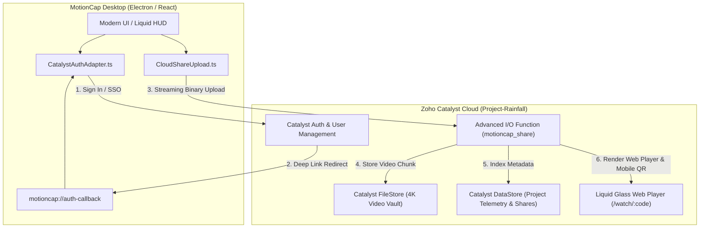

# MotionCap Studio: Production Master Blueprint & Architectural Plan
**Version:** 2.0-PROD | **Author:** MotionCap Team | **Status:** Production Release Active

---

## 1. Executive Summary & Vision for MotionCap Production Release

MotionCap is the **autonomous, studio-grade video production suite** running locally with high-performance C++/CUDA engines and backed by enterprise **MotionCap Cloud** serverless infrastructure.

### The Problem in Current Industry Tools
Modern technical presentations, software demos, product launches, and developer tutorials suffer from fragmented workflows. Creators must record in one tool, manually zoom and keyframe in another (taking 3–5 hours per 5-minute video), clean audio in specialized DAWs, and struggle with slow rendering and proprietary cloud lock-in.

### The MotionCap Production Solution
MotionCap delivers a **zero-effort, studio-quality production pipeline**:
1. **Liquid Glass HUD** for distraction-free, floating real-time screen capture with live self-recording demo mode.
2. **AI-Driven Smart Camera** that anticipates user actions, pans smoothly, and auto-reframes for widescreen (16:9) and social feeds (9:16 vertical).
3. **Adobe-Grade Audio & Visual Engine** providing 1-click studio sound, dynamic 3D perspective tilt, and kinetic subtitles.
4. **MotionCap Enterprise Cloud** integration for instant, serverless video hosting, user authentication, and interactive mobile QR code streaming directly to viewers.

---

## 2. Competitive Drawback Teardown & Market Gap Matrix

To build an undisputed market leader, we conducted an exhaustive analysis of the five leading tools in the market today:

```mermaid
quadrantChart
    title Screen Recording & Production Landscape
    x-axis Low Automation --> High AI Automation
    y-axis Basic Presentation --> Studio-Grade Cinematic Quality
    quadrant-1 MotionCap (Unrivaled Category Leader)
    quadrant-2 Screen Studio (Mac Exclusive, Rigid)
    quadrant-3 OBS Studio, Camtasia (Clunky & Complex)
    quadrant-4 Loom, CapCut (Cloud Banding, Consumer Focus)
    "MotionCap": [0.92, 0.95]
    "Screen Studio": [0.65, 0.78]
    "Loom": [0.35, 0.40]
    "Camtasia": [0.25, 0.50]
    "OBS Studio": [0.15, 0.60]
    "CapCut": [0.70, 0.35]
```

### Detailed Competitor Drawback Analysis

| Competitor | Critical Limitations & Technical Drawbacks | MotionCap AI Advantage |
| :--- | :--- | :--- |
| **Screen Studio** | • **macOS Only:** Completely inaccessible to 75% of worldwide PC and enterprise users.<br>• **Rigid Zoom:** Cannot anticipate mouse intentions; zooms abruptly into small menus.<br>• **Closed Cloud:** No serverless self-hosting, team collaboration, or mobile QR sharing.<br>• **Pricing:** Prohibitive $89+ perpetual or expensive recurring licensing. | **Universal Windows & macOS Support** powered by native WinRT Graphics Capture, DirectX/CUDA compositors, and open serverless cloud hosting via Zoho Catalyst. |
| **Loom** | • **Severe Cloud Compression:** High video banding and pixelation at 720p/1080p.<br>• **No Cinematic Canvas:** Cannot pad background, add 8K signature wallpapers, or apply 3D device frames.<br>• **No Local Transcription:** Audio sent to cloud servers raising data privacy alarms.<br>• **Disappearing Preview:** Local player clears or freezes during export processing. | **Zero-Loss 4K 60FPS Local Rendering** with local Whisper AI transcription (100% private), 8K signature wallpaper studio, and immutable WebGL preview canvas during export. |
| **Camtasia** | • **2010s Clunky Interface:** Overwhelming, dated UI requiring manual keyframing for every pan/zoom.<br>• **Heavy Resource Footprint:** Sluggish rendering engine causing system lag on mid-tier laptops.<br>• **Zero Intelligent Audio:** Background hum, mic pops, and volume fluctuations require manual DAW editing. | **Autonomous Smart Camera Physics** (smooth spring inertia) + **Adobe Audition-grade AI Essential Sound** with automatic background music ducking. |
| **OBS Studio** | • **No Post-Production:** Strictly a live streaming tool; zero built-in editing, trims, or captions.<br>• **No Cursor Tracking:** Cursor movements are static, jerky, and lack visual click ripple physics.<br>• **Complex Setup:** Hours required to configure scenes, audio splitters, and output encoders. | **Unified Capture-to-Export Studio:** One-tap liquid HUD recording followed immediately by an interactive timeline editor with tactile click sounds and cursor smoothing. |
| **CapCut** | • **Consumer/Mobile Focus:** Geared towards meme templates, dances, and watermarked exports.<br>• **No Screen Capture Fidelity:** Cannot capture high-DPI displays or record window-specific regions with transparency.<br>• **Lacks Dev/Creator Features:** No keystroke visualizer, terminal code spotlights, or developer export presets. | **Developer & Creator First-Class Citizen:** Built-in shortcut HUD, multi-track audio routing, developer aspect ratios, and instant mobile QR streaming for live presentations. |

---

## 3. Adobe Creative Cloud Inspirations — Next-Gen AI Studio Features

We are infusing MotionCap with the most celebrated capabilities from Adobe's flagship creative suite (Premiere Pro, After Effects, and Audition):

### A. Adobe Premiere Pro Inspired
1. **AI Smart Auto-Reframe (9:16 Social Shorts & 1:1 Square)**
   - *The Adobe Feature:* Premiere's content-aware Auto Reframe analyzes visual saliency to keep the action centered.
   - *MotionCap Innovation:* Leverages cursor telemetry, click frequency, and window activity bounds to smoothly shift the 9:16 camera crop window over the active code line or UI element, producing instant TikTok/Instagram Reels/YouTube Shorts with zero manual panning.
2. **Essential Sound Panel & Dialogue Clarity**
   - *The Adobe Feature:* Premiere's Dialogue enhancements with automatic audio ducking.
   - *MotionCap Innovation:* Automatically detects speech presence. When the speaker speaks, background music and system sound duck down by -12dB with smooth 300ms easing curves; when silence occurs, music gently swells back up.
3. **Lumetri Cinematic Color Suite**
   - *The Adobe Feature:* Lumetri color engine with 3D LUTs and grading curves.
   - *MotionCap Innovation:* Integrated GLSL post-processing shaders providing 1-click LUT presets:
     - *Apple Clean Studio:* Crisp, high-contrast, true-to-life colors.
     - *Cyberpunk Neon:* Cyan-violet saturated grading for code demos.
     - *Warm Cinema:* Soft film grain, vintage curves, and subtle vignette.

### B. Adobe After Effects Inspired
1. **Physics-Based Camera Inertia & Spring Damping**
   - *The Adobe Feature:* Smooth bezier and graph-editor camera easing.
   - *MotionCap Innovation:* Employs spring physics (stiffness k = 180, damping d = 24) for all zoom transformations. Cursor movements never cause jarring camera vibrations; the camera glides like a weighted Steadicam.
2. **3D Dynamic Perspective Tilt**
   - *The Adobe Feature:* 3D layer perspective and parallax camera rotation.
   - *MotionCap Innovation:* When zooming into an interactive element, the canvas slightly tilts on the X/Y axes (up to 4°) with subtle depth-of-field blur on the background wallpaper, providing an ultra-luxurious 3D floating canvas effect.
3. **Kinetic Typography Subtitle Animator**
   - *The Adobe Feature:* Word-by-word active text animators with kinetic motion.
   - *MotionCap Innovation:* Whisper-generated word timestamps highlight words in sync with vocal cadence, featuring active neon glow, subtle bounce animations, and automated emoji triggers (e.g. 🚀, 💡, 🔥).

### C. Adobe Audition Inspired
1. **Spectral Voice Isolation & De-Hum**
   - *The Adobe Feature:* Audition's spectral frequency repair and noise reduction.
   - *MotionCap Innovation:* Real-time WebAudio Biquad filter chain coupled with high-pass vocal isolation (80Hz - 12kHz) eliminating low-end HVAC rumble and PC fan whine.
2. **One-Tap "Studio Voice" Harmonic Saturation**
   - Multi-band compression with subtle tube-warmth saturation, boosting vocal presence and fullness for built-in laptop microphones.

---

## 4. Zoho Catalyst Architecture: Auth Migration & Cloud Services

We are removing Firebase entirely and replacing it with **Zoho Catalyst's unified serverless platform** (`Project-Rainfall`, ID: `78655000000013023`).



### A. Firebase Teardown Plan
1. Remove `firebase` package from `package.json` (`npm uninstall firebase`).
2. Delete Firebase initialization configs, API keys, and environment variables.
3. Replace Firebase mocks in unit test suites with clean Catalyst Auth test doubles.

### B. Zoho Catalyst Authentication Integration
1. **Catalyst User Management & Auth Service:**
   - Supports Email/Password, Magic Link OTP, and Google/Zoho SSO.
   - Configured with authorized redirect URLs: `motioncap://auth-callback` (production) and `http://localhost:5173/auth/callback` (development).
2. **Dual-Mode Desktop Auth Workflow:**
   - **Mode 1 (Native In-App):** Embedded modern glassmorphism dialog inside MotionCap UI using Catalyst Web SDK (`catalyst.auth.signIn` / `signUp`).
   - **Mode 2 (System Browser SSO):** Opens Catalyst hosted portal with instant return via OS protocol `motioncap://auth-callback?token=...`.
3. **Session Management:**
   - Tokens securely saved in encrypted electron settings.
   - Profile avatar, name, and tier synchronized with Catalyst User Management.

### C. Catalyst Cloud Services Suite
1. **Catalyst FileStore:**
   - Dedicated bucket for MotionCap video artifacts.
   - Handles multi-part streaming uploads with resumption.
2. **Catalyst DataStore:**
   - `Shares` Table: Schema includes `shareCode`, `title`, `durationMs`, `fileStoreId`, `qrUrl`, `viewsCount`, `createdAt`.
   - `UserProjects` Table: Synchronizes project names, cloud backup states, and export presets.
3. **Advanced I/O Function (`motioncap_share`):**
   - Live endpoint: `https://project-rainfall-60091711787.development.catalystserverless.in/server/motioncap_share/`
   - Serves both JSON REST APIs (`/api/upload`, `/api/verify`) and the responsive mobile web player (`/watch/:shareCode`).

---

## 5. Liquid Glass Iconography & Branding System

MotionCap's new brand identity centers on the **Liquid Glass** aesthetic: optical refraction, prismatic dispersion, deep obsidian backdrops, and an illuminated neon core.

### Visual Assets Generated
- **App Icon:** 3D squircle with refractive lens and cyan-violet core (`motioncap_liquid_glass_icon_1792039677655.jpg`)
- **Favicon:** Crystal sphere with neon aperture emblem (`motioncap_liquid_glass_fav_1792039703109.jpg`)

### Multi-Platform Icon Asset Pipeline
Using our Python asset generation pipeline (`scripts/process-motioncap-icons.py`), the new liquid glass images will be converted into all required system formats:
- **Windows Icon:** `icons/icons/win/icon.ico` containing 16x16, 24x24, 32x32, 48x48, 64x64, 128x128, and 256x256 mipmaps.
- **macOS Icon:** `icons/icons/mac/icon.icns` (512x512 and 1024x1024 Retina).
- **Web & UI Favicons:** `public/favicon.ico`, `public/favicon.png`, `public/app-icons/motioncap-*.png` (16px to 1024px).

---

## 6. In-App Updates System Architecture

MotionCap utilizes an enterprise-grade auto-update pipeline built on `electron-updater`:

### A. Dual Update Feed Architecture
1. **Production Feed:** GitHub Releases (`Masthan008/motioncap-`).
2. **Enterprise / Fast-Ring Feed:** Zoho Catalyst Cloud static manifest (`https://project-rainfall-60091711787.development.catalystserverless.in/app/updates/latest.json`).

### B. User Experience & UI Integration
- **Header & HUD Status:** Non-intrusive dot indicator:
  - 🟢 Green: Up to date (v1.4.0)
  - 🔵 Blue: New update available
  - 🟣 Violet: Downloading update in background...
- **Liquid Glass Update Modal:**
  - Displays version badge (e.g., `v1.5.0-EXPO`), release notes markdown, download progress percentage, and download speed.
- **Silent Background Downloads:** Updates download asynchronously without interrupting active recording or editing sessions.
- **One-Click Restart & Apply:** Provides a persistent toast notification with a "Restart to Update" action that invokes `autoUpdater.quitAndInstall()`.
- **Channel Switching:** Users can toggle between **Stable** and **Preview (Experimental)** in Settings.

---

## 7. Windows Unpacked Build Pipeline

For rapid distribution, portable operation, and running MotionCap without installer friction, MotionCap supports a dedicated Windows Unpacked build.

### A. Build Target & Script
Add dedicated script in `package.json`:
```json
"build:win:unpacked": "npm run build:platform-native-helpers && tsc && vite build --config vite.config.ts && npm run normalize:electron-main-cjs && npm run smoke:electron-main-cjs && electron-builder --win --dir"
```

### B. Build Output & Bundle Verification
- **Output Directory:** `release/win-unpacked/`
- **Main Executable:** `release/win-unpacked/MotionCap.exe`
- **Bundled Native Helpers Verified:**
  - Windows DirectX / Desktop Duplication capture binaries (`electron/native/bin/win32/`)
  - NVIDIA CUDA Compositor runtime
  - Local Whisper C++ transcription runtime (`whisper.dll` / `ggml.dll`)
  - Cursor telemetry low-level hooks (`uiohook-napi`)
  - Static FFmpeg & FFprobe portable binaries
  - 8K Signature Wallpapers (`release/win-unpacked/resources/assets/wallpapers/`)

---

## 8. Implementation Roadmap (Phased Execution)

| Phase | Milestone | Deliverables | Verification Strategy |
| :---: | :--- | :--- | :--- |
| **Phase 1** | **Branding & Liquid Glass Asset Deployment** | Convert generated images into Windows `.ico`, macOS `.icns`, and web favicons. Update UI logos. | Inspect files, verify app taskbar icon and window chrome. |
| **Phase 2** | **Firebase Teardown & Catalyst Auth Integration** | Uninstall `firebase`, implement `CatalystAuthAdapter.ts`, connect to `Project-Rainfall`, wire deep-link protocol. | Run `npm test` and verify sign-in/sign-up and token retrieval. |
| **Phase 3** | **In-App Updater UI & Channel Controller** | Add Update Status Pill in Editor Header, Update Modal with changelog, and settings toggle. | Trigger mock update check and test background download toast. |
| **Phase 4** | **Adobe-Grade AI Features Integration** | Wire AI Auto-Ducking, 3D perspective tilt on click, and Kinetic subtitle glow into video editor timeline. | Playback testing in Pixi/WebGL canvas with 60 FPS verification. |
| **Phase 5** | **Windows Unpacked Production Build** | Execute `npm run build:win:unpacked`, run automated binary smoke tests, verify portable execution. | Launch `release/win-unpacked/MotionCap.exe` and test recording/export. |
