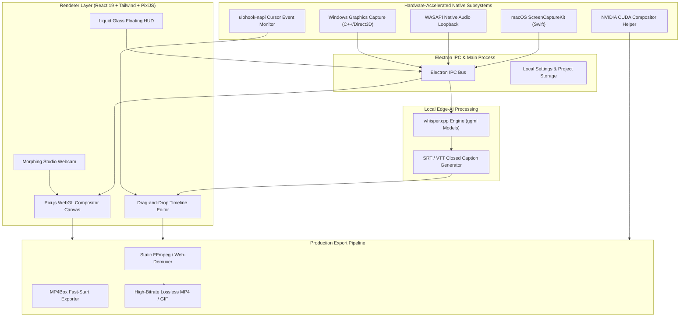

# MOTIONCAP TECHNICAL DOSSIER & PROBLEM STATEMENT

**Project Title:** MotionCap Studio  
**Subtitle:** An AI-Accelerated, High-Performance Indigenous Studio Suite for Automated Digital Pedagogy and Technical Knowledge Capture  
**Category:** Software Systems / Digital Education (EdTech) / Edge AI / Open Source Desktop Studio  

---

## 1. Executive Summary

As technical education undergoes a historic digital transformation under the **National Education Policy (NEP 2020)**, the demand for high-quality, reproducible digital learning content (video lectures, coding walkthroughs, simulation tutorials, and virtual laboratory guides) has skyrocketed. However, educators, researchers, and engineering students face a severe bottleneck: producing professional, presentation-ready instructional video content currently requires either expensive proprietary foreign software or hours of manual editing in complex post-production suites.

**MotionCap** is a native, open-source, edge-AI-accelerated desktop application engineered to eliminate the post-production barrier in technical content creation. By combining **hardware-accelerated native screen capture**, **cursor-aware automated cinematic camera zooms**, **real-time liquid glass presenter overlays**, and **100% offline, privacy-first Whisper AI transcription**, MotionCap transforms raw screen recordings into studio-grade technical tutorials within seconds—with zero manual video editing required.

---

## 2. Problem Statement

### 2.1 Context & Background
In modern engineering and technical curricula, screencasting is the primary vehicle for asynchronous knowledge transfer—spanning coding tutorials, CAD/CAM demonstrations, microcontroller simulations, and data science notebooks. Despite its ubiquity, standard screen recordings are difficult for students to follow due to tiny IDE fonts, rapid erratic cursor movements, lack of visual focus, and absent subtitles.

### 2.2 Core Problem Vectors

```
                      ┌──────────────────────────────────────────────┐
                      │    The Digital Screencasting Crisis          │
                      │    in Technical Higher Education             │
                      └──────────────────────┬───────────────────────┘
                                             │
      ┌──────────────────┬───────────────────┼───────────────────┬──────────────────┐
      ▼                  ▼                   ▼                   ▼                  ▼
[Time & Effort]     [Economic]         [Platform Lock]     [Data Privacy]    [Accessibility]
 4-6 hrs manual     $89 - $300/yr       macOS exclusivity    Cloud exposure     Zero captions;
 editing per video  licensing cost      blocks Windows/Linux of IP & code      excludes deaf & ESL
```

1. **The Post-Production Overhead Bottleneck:**
   - Raw screen captures are static and hard to view on mobile devices or standard college screens.
   - To make tutorials readable, instructors must manually keyframe camera zooms into code lines, smooth cursor paths, add styled backgrounds, and trim mistakes using non-linear video editors (Premiere Pro, DaVinci Resolve). This adds **4 to 6 hours of editing time per 1 hour of lecture**.
2. **Prohibitive Licensing & Foreign Monopolies:**
   - High-end automated screencasting tools are strictly commercial monopolies (e.g., *Screen Studio* at $89+, *TechSmith Camtasia* at $300+, *Loom* at $150/year).
   - These tools are financially inaccessible to tier-2 and tier-3 colleges, government institutions, and students across India.
3. **Platform Exclusivity & Operating System Divide:**
   - The leading aesthetic screen capture solutions are exclusively built for macOS. More than **85% of Indian technical academia and engineering students rely on Windows and Linux**, leaving them completely underserved.
4. **Data Privacy, Intellectual Property & Cloud Egress Vulnerabilities:**
   - Cloud-based screen recorders (Loom, Vidyard) upload internal recordings directly to foreign cloud servers.
   - In academic institutions and defense/R&D labs, recording confidential proprietary source code, student personal credentials, or institutional examinations via cloud tools violates data sovereignty and security policies.
5. **Accessibility & Linguistic Inclusivity Deficit:**
   - Technical tutorials rarely feature accurate closed captions due to the labor involved in manual transcription.
   - This disenfranchises hearing-impaired students (*Divyangjan*) and non-native English speakers attempting to parse complex technical terminology.
6. **Hardware Resource Constraints on Consumer Hardware:**
   - Conventional screen recording software causes high CPU throttling and frame drops when running concurrently with resource-heavy engineering workloads (such as Android Studio, MATLAB, ROS, or Docker).

---

## 3. How We Have Solved It: The MotionCap Solution

MotionCap resolves these challenges through an integrated, cross-platform architecture that combines native systems engineering with on-device edge AI.

### 3.1 Key Architectural Solutions

```
+-----------------------------------------------------------------------------------+
|                            MOTIONCAP SYSTEM OVERVIEW                              |
+-----------------------------------------------------------------------------------+
|  [PRESENTATION LAYER]                                                             |
|   - visionOS Liquid Glass Floating HUD (Zero-Intrusion Controls)                  |
|   - Multi-Shape Morphing Studio Webcam (Squircle / Circle / Pill / 4:5 Portrait)  |
|   - Pixi.js 8 WebGL Composition Engine (Smooth 60 FPS Canvas)                     |
+-----------------------------------------------------------------------------------+
                                         │
                                         ▼
|  [AUTOMATED CINEMATIC FOCUS & MOTION]                                             |
|   - Low-Level Global Cursor Hook (uiohook-napi / System Cursor Tracking)          |
|   - Physics-Based Cursor Smoothing, Inertia Sway & Dynamic Click Bounce           |
|   - Heuristic Auto-Zoom: Detects typing clusters & clicks to auto-frame active ROI|
+-----------------------------------------------------------------------------------+
                                         │
                                         ▼
|  [HARDWARE-ACCELERATED NATIVE CAPTURE]                                            |
|   - Windows: Windows Graphics Capture (WGC) + WASAPI Audio Loopback (DirectX C++) |
|   - macOS: Native ScreenCaptureKit (SCK) in Swift (Zero-Copy Frame Pipeline)      |
|   - Linux: Electron DesktopCapture with X11/Wayland support                       |
+-----------------------------------------------------------------------------------+
                                         │
                                         ▼
|  [EDGE-AI ACCESSIBILITY & AUDIO PIPELINE]                                         |
|   - Embedded Local whisper.cpp Runtime (No Cloud / Zero Internet Required)        |
|   - Automatic Timestamped Subtitle (SRT/VTT) Generation                           |
|   - High-Fidelity Audio Normalizer & Dynamic Limiter                              |
+-----------------------------------------------------------------------------------+
                                         │
                                         ▼
|  [EXPORT & ENCODING ENGINE]                                                       |
|   - Hardware-Tuned Bitrate Pipeline (Up to 85 Mbps 4K Lossless Quality)           |
|   - NVIDIA CUDA Compositor & Native GPU Encoder Probing                           |
|   - Web-Demuxer, MP4Box, & Static FFmpeg Binary Pipelines                         |
+-----------------------------------------------------------------------------------+
```

---

### 3.2 Core Feature Innovations

#### A. Automated Camera Choreography (Zero-Effort Focus)
- **Problem Solved:** Instructors waste hours manually adding pan and zoom keyframes so students can see code or small buttons.
- **Implementation:** MotionCap monitors global cursor coordinates and click density. The timeline editor automatically generates predictive zoom regions, smoothly focusing on the active working region and panning with cursor inertia.

#### B. 100% Offline Edge-AI Transcription (`whisper.cpp`)
- **Problem Solved:** Subtitles require cloud subscriptions or manual transcription; sensitive research videos cannot leave the local network.
- **Implementation:** MotionCap integrates an embedded, precompiled `whisper.cpp` runtime directly inside the desktop application package. It transcribes audio on the user’s local CPU/GPU, producing synchronized captions without requiring internet connectivity, API keys, or cloud uploads.

#### C. Indigenous Low-Level Hardware Optimization
- **Problem Solved:** High CPU usage and blurry terminal text caused by generic browser capture wrappers.
- **Implementation:**
  - **Windows:** Custom C++ helper utilizing **Windows Graphics Capture (WGC)** with Direct3D surfaces and WASAPI low-latency loopback.
  - **macOS:** Pure Swift helper calling Apple's **ScreenCaptureKit**.
  - **NVIDIA GPU Acceleration:** Direct CUDA compositor helper for ultra-fast, hardware-accelerated video compositing and export.

#### D. Studio Aesthetics for Every Educator
- **Problem Solved:** Plain screen recordings look unengaging and amateurish.
- **Implementation:** Includes signature 8K studio wallpapers, customizable canvas aspect ratios (16:9 for YouTube/NPTEL, 9:16 for short educational reels), drop shadows, rounded corners, and a visionOS-inspired liquid glass webcam frame with audio-reactive specular lighting.

---

## 4. Comprehensive Comparison Matrix

| Evaluation Parameter | Standard Screen Recorders (OBS / ShareX) | Cloud Recorders (Loom / Vidyard) | Commercial Mac Tools (Screen Studio) | **MotionCap Studio** |
| :--- | :--- | :--- | :--- | :--- |
| **Target Audience** | Gamers / Streamers | Corporate Sales / Messaging | Apple Mac Designers | **Educators, Engineers & Developers** |
| **Automated Pan/Zoom** | ❌ None | ❌ None | ✅ Yes | **✅ Yes (Cursor & Click-Aware Heuristics)** |
| **Cursor Smoothing** | ❌ Raw mouse | ❌ None | ✅ Yes | **✅ Yes (Inertia, Bounce, Sway, macOS-Style)** |
| **AI Transcription** | ❌ None | ⚠️ Cloud-only (Paid) | ⚠️ Cloud-dependent | **✅ 100% Offline Local Whisper Engine** |
| **Platform Support** | Windows / Mac / Linux | Browser / Desktop | ❌ macOS Only | **✅ Windows, macOS, and Linux** |
| **Data Privacy** | ✅ Local | ❌ Uploads to external cloud | ⚠️ Mixed | **✅ Zero telemetry; 100% edge-computed** |
| **Cost to Student/Faculty**| Free (High learning curve)| Subscription ($150+/yr) | Expensive ($89+ One-Time) | **Free & Open-Source (AGPL-3.0)** |
| **Built-in Timeline Editor**| ❌ External NLE needed | ⚠️ Basic trim | ✅ Yes | **✅ Full Timeline (Zooms, Trims, Captions)** |

---

## 5. Educational Alignment & Global Impact

### 5.1 Alignment with National Education Policy (NEP 2020)
- **Pedagogical Digitization:** Under NEP 2020 Section 24, higher education institutions are mandated to build indigenous digital repositories and MOOC courses. MotionCap allows any assistant professor or lab assistant to create international-quality video content using standard lab PCs.
- **Empowering Tier-2 & Tier-3 Institutions:** Eliminates the financial barrier that separates elite universities from regional engineering colleges in educational content quality.

### 5.2 Divyangjan & Accessibility Compliance
- Provides automatic, offline-generated subtitles, making STEM and engineering videos accessible to students with hearing impairments in compliance with Indian accessibility mandates.

### 5.3 Atmanirbhar Bharat & Indigenous Software Sovereignty
- Eliminates dependence on foreign commercial video utility vendors.
- Protects national research and academic intellectual property by keeping 100% of video processing, audio data, and transcription on local machines.

---

## 6. System Architecture & Technical Stack



- **Frontend / Renderer:** React 19, TypeScript, Pixi.js v8 (hardware-accelerated WebGL rendering), TailwindCSS v4, HeroUI, dnd-timeline.
- **Native System Modules:** Windows Graphics Capture (WGC API), DirectX 11 Direct3D surfaces, Windows WASAPI audio subsystem, macOS ScreenCaptureKit (Swift), `uiohook-napi` global event listener.
- **Edge AI Engine:** Embedded `whisper.cpp` v1.8.4 runtime with quantized GGML models (`base` / `small`).
- **Media & Export Pipeline:** FFmpeg-static, MP4Box, Web-Demuxer, Mediabunny, lossless VP9/H.264 profiles up to 85 Mbps.

---

## 7. The 60-Second Live Demonstration Protocol

When demonstrating MotionCap Studio, follow this structured, high-impact demonstration sequence:

```
[00:00 - 00:15] INITIATION & RECORDING
- Press F9 to trigger recording from the transparent Liquid Glass HUD.
- Open VS Code or terminal; write a short function while explaining aloud via microphone.
- Demonstrate the responsive webcam with real-time audio-reactive lighting.

[00:15 - 00:30] AUTOMATED CAMERA CHOREOGRAPHY
- Stop recording with F9.
- Show the editor window opening automatically.
- Highlight the Timeline: the application has automatically identified the exact area 
  where the code was typed and inserted smooth, cinematic pan-and-zoom keyframes.

[00:30 - 00:45] OFFLINE WHISPER AI SUBTITLE GENERATION
- Click 'Transcribe Audio' in the editor panel.
- Point out: "Notice our laptop is in Airplane Mode. No internet is connected."
- Within seconds, synchronized, timecoded subtitles appear directly aligned with speech.

[00:45 - 01:00] ONE-CLICK 4K LOSSLESS EXPORT
- Select 16:9 SWAYAM / YouTube preset or 9:16 Mobile reel preset.
- Click Export.
- Play the exported video side-by-side with raw footage to show the dramatic difference:
  sharp 4K text, polished cursor motion, professional backdrop, and synchronized captions.
```

---

## 8. Current Validation & Future Roadmap

### 8.1 Completed & Validated Milestones
- [x] Full native Windows Graphics Capture (WGC) and macOS ScreenCaptureKit integration.
- [x] Embedded `whisper.cpp` native runtime with custom model paths and automated download.
- [x] Interactive multi-track timeline supporting zooms, trims, speed regions, and audio overlays.
- [x] Liquid glass visionOS floating HUD and studio webcam with shape morphing.
- [x] High-bitrate 4K 60FPS export pipeline with lossless presets.

### 8.2 Roadmap for National Technical Deployment
1. **Multilingual Indian Vernacular Subtitling (Bhashini API / Indic-Whisper):**
   - Integrate fine-tuned Indic-language models to generate instant captions in Hindi, Tamil, Telugu, Marathi, Bengali, and Kannada for regional technical instruction.
2. **Pedagogical Privacy / Automated Redaction:**
   - Computer vision algorithm to automatically detect and blur sensitive on-screen tokens, such as database connection strings, API secrets, student roll numbers, or personal emails.
3. **Automated Chapter & Assessment Generation:**
   - Using local Small Language Models (SLMs) to process the Whisper transcript and automatically generate video chapters, lecture summaries, and sample viva-voce quiz questions.
4. **Direct Institutional LMS Integration:**
   - One-click packaging into SCORM / Moodle / SWAYAM compliant packages.

---

## 9. Conclusion

**MotionCap** addresses a critical pedagogical and technological friction point in technical higher education. By combining deep systems programming (C++, Swift, DirectX, CUDA) with on-device artificial intelligence (Whisper.cpp) and modern graphics engineering (Pixi.js, WebGL), it delivers an indigenous, accessible, and privacy-preserving platform that empowers educators and students to communicate technical knowledge with clarity and impact.

It solves real educational and content-creation challenges through high-caliber, independent engineering.
